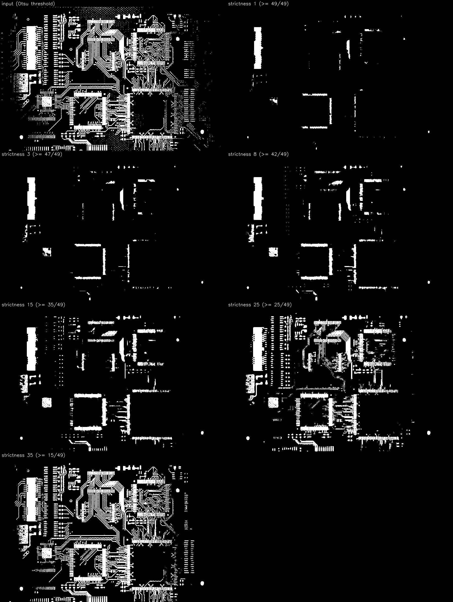
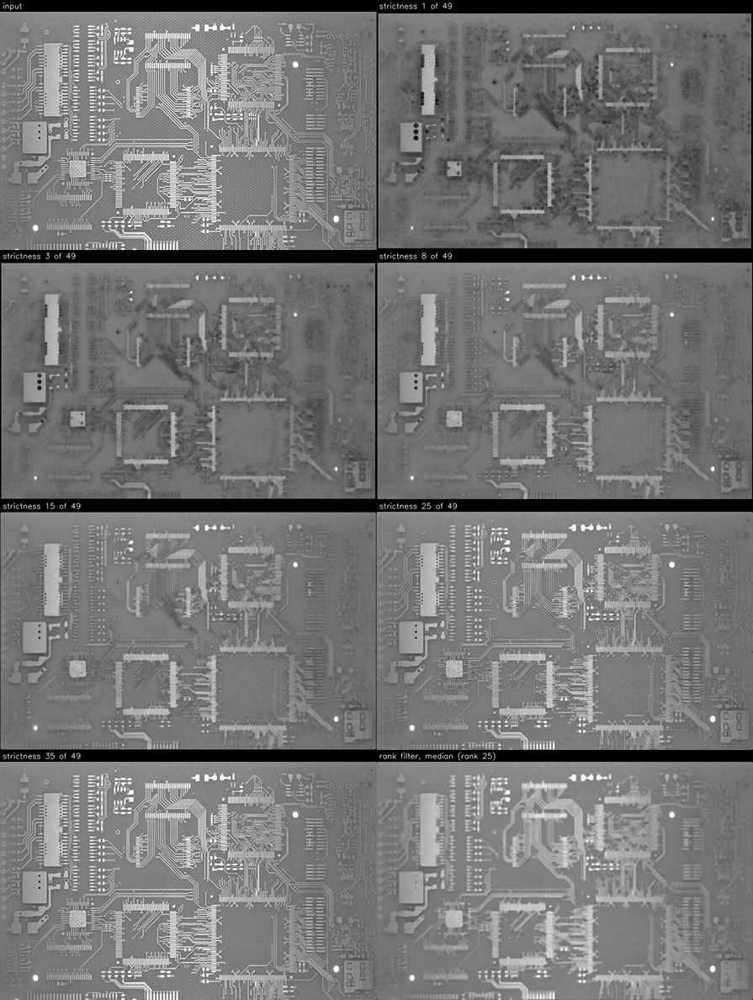
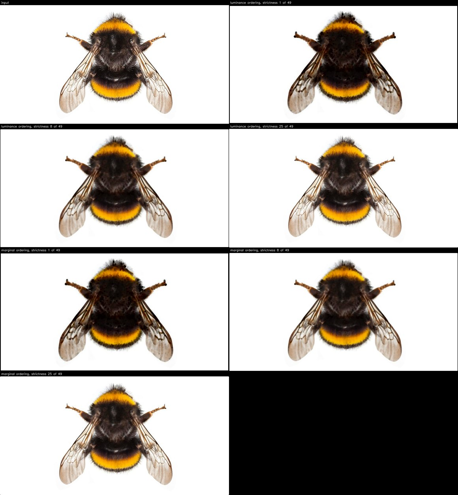
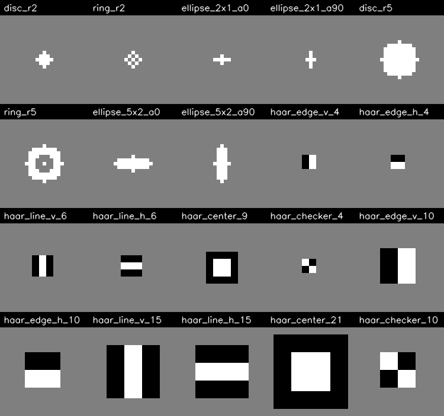
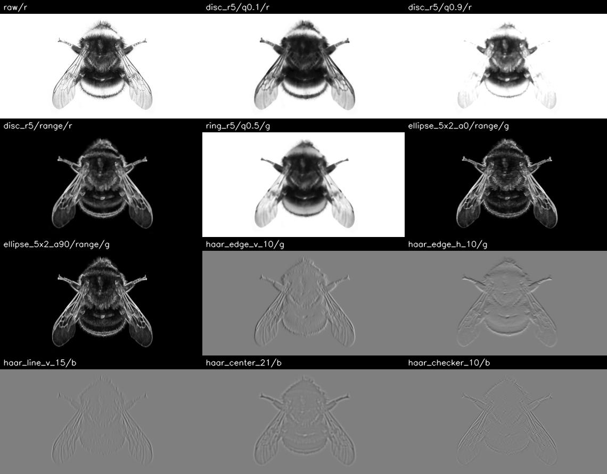

# img-proc

GPU image-processing experiments with [PyCUDA](https://documen.tician.de/pycuda/). The CUDA
kernels live in `cuda/` as plain `.cu` files; the Python scripts read and compile them at run time.

| Topic | Python | CUDA kernels |
| --- | --- | --- |
| Symmetry detection | `sym_measure_example.py` | `cuda/sym_measure.cu` |
| Regulated morphological erosion, rank filter | `regulated_morph.py` | `cuda/regulated_morph_erosion.cu` |
| Colour rank filter, segmentation feature maps | `regulated_morph.py`, `morph_features.py`, `structuring_elements/` | `cuda/morph_features.cu` |

## Requirements

- An NVIDIA GPU with the CUDA toolkit (`nvcc` on the `PATH`). The kernels use legacy texture
  references, which CUDA 12 removed, so use CUDA 11.
- Python 3.10 with `pycuda`, `numpy`, `opencv-python` and `Pillow` (Pillow is only needed for the GIF).

The kernels are compiled with `arch='sm_80'`; change that argument in the `SourceModule(...)`
calls if your GPU needs a different target.

## Symmetry detection

`sym_measure_example.py` implements the two methods of Zielke, Brauckmann and von Seelen,
*Intensity and Edge-Based Symmetry Detection Applied to Car-Following* (ECCV 1992, `eccv_92.pdf`).

```
python sym_measure_example.py
```

The input is `street_view.jpg`.

### Intensity symmetry per pixel

For a scan line through a pixel, the intensities on both sides are split into an even and an
odd part. Comparing their energies gives a symmetry measure `S` in [-1, 1] (1 = mirror
symmetric, -1 = antisymmetric). Weighting `S` by the width of the interval gives the axis
confidence `SA` in [0, 1], so wide symmetric intervals count more than narrow ones.

`symmetry_image(angle)` returns, for every pixel, the largest `SA` over all interval widths,
the width where it occurs, and `S` at that width. The angle sets the scan direction:
0 scans along y (horizontal symmetry axes), π/2 scans along x (vertical axes).

`symmetry_angle_series()` renders `SA` for 30 scan angles from 0 to π/2 into `sym_series/`
as PNG frames and an animated GIF. All frames share one grey scale (`SA = 1` is white).

`MAX_HALF_WIDTH` sets the largest half-width of the interval tested around each pixel, and
with it the scale of the structures that respond. A small value picks out fine local detail
such as edges, lane markings and car contours; a large value responds to symmetry of whole
objects and regions.

| `MAX_HALF_WIDTH = 20` | `MAX_HALF_WIDTH = 150` |
| --- | --- |
|  |  |

### Symmetry histogram

`symmetry_histogram(horizontal=False)` sums `SA` over parallel scan lines for every axis
position and interval width. Its peaks are the symmetry axes of the image. It handles vertical
axes (`horizontal=False`) and horizontal axes (`horizontal=True`). The script writes the
histograms to `result_hist_vertical.png` and `result_hist_horizontal.png`.

### SEED, the symmetry-enhancing edge detector

`seed_image(axis_pos, max_dist, horizontal=False)` keeps only the edges that have a
mirror-symmetric counterpart across a given axis. Each pixel is paired with its mirror point;
eight directional edge responses on both sides are compared through the compatibility table of
the paper's Fig. 3. The script runs SEED at the strongest axis of each orientation and writes
`result_seed_vertical.png` and `result_seed_horizontal.png`.

## Regulated morphological erosion

`regulated_morph.py` is a Python port of the MATLAB/CUDA code in `gen_morph/`.

Ordinary erosion keeps a foreground pixel only if every pixel under the structuring element
is foreground. Regulated erosion relaxes this with a `strictness` parameter: a pixel survives
if at most `strictness - 1` pixels under the structuring element are background. Strictness 1
is ordinary erosion; larger values erode less and are more tolerant of noise and small holes.

```python
from regulated_morph import gen_morph_kernel, regulated_erosion

kernel = gen_morph_kernel(4)                    # disc of radius 4, 49 pixels
eroded = regulated_erosion(binary, kernel, strictness=8)
```

### Binary images

```
python regulated_erosion_example.py
```

Thresholds `circuit.jpg` (Otsu) and erodes it with a radius-4 disc at several strictness
values. Results go to `regulated_erosion_out/`.



### Greyscale images: order-statistic filter

The greyscale version is an order-statistic (rank) filter. With strictness as the rank, the
output is the smaller of the pixel's own value and the `strictness`-th smallest intensity under
the structuring element. On a 0/255 image this gives exactly the binary result.

- `regulated_erosion_gray(image, kernel, strictness)`: greyscale regulated erosion.
- `rank_filter(image, kernel, rank)`: the plain rank filter. Rank 1 is the minimum (erosion),
  the middle rank is the median, the top rank is the maximum (dilation).

Both take 8-bit images. The kernel does not sort: it finds the rank-th smallest value by
bisecting the 0–255 intensity range, counting the neighbours at or below the midpoint in
each of 8 passes.

```
python regulated_erosion_gray_example.py
```

Results go to `regulated_erosion_gray_out/`.



### Notes

- Structuring-element pixels outside the image count as background (intensity 0), so low
  strictness values darken a band of up to one radius along the image border.
- `gen_morph_kernel` returns `(dx, dy)` offsets. The MATLAB original used linear indices, which
  wrapped around at the left and right image edges.

## Colour images and feature maps for segmentation

```
python morph_features_example.py
```

Reads `bumble.jpg` and writes its results to `morph_features_out/`.

### Colour regulated erosion

Colours have no natural order, so "the rank-th smallest colour" needs a definition.
`rank_filter_color` and `regulated_erosion_color` in `regulated_morph.py` offer two:

- `ordering='luminance'` (default): vector ordering. The pixels under the structuring
  element are ordered by brightness and the whole colour of the rank-th darkest pixel is
  returned. Every output colour exists in the neighbourhood, so no false colours appear.
- `ordering='marginal'`: each channel is rank-filtered on its own. This is exactly the
  greyscale filter per channel, but it can combine channels from different pixels into
  colours that are not in the image.

On a grey image stored as colour, both give the greyscale regulated erosion.



### Structuring elements

The `structuring_elements/` package defines the neighbourhoods the filters work on. A
`StructuringElement` holds `(dx, dy)` offsets and, optionally, one weight per offset.

| Module | Kind | Elements |
| --- | --- | --- |
| `shapes.py` | flat, for rank and morphological filters | `disc`, `ring`, `ellipse`, `rectangle`, `square`, `line`, `cross` |
| `haar.py` | weighted, for linear filters | `haar_edge`, `haar_line`, `haar_center_surround`, `haar_checker` |
| `bank.py` | ready-made lists over several scales | `flat_bank`, `haar_bank` |

Haar-like elements have a positive and a negative region, scaled so that the response is the
mean of the positive region minus the mean of the negative region. `StructuringElement.from_mask`
builds an element from any 2D array. All functions in `regulated_morph.py` accept a flat
`StructuringElement` in place of an offset array.

The default bank (white: in the element or positive weight, black: negative weight):



### MorphFeatureMap

`MorphFeatureMap` in `morph_features.py` turns an image into a stack of per-pixel feature
planes, meant as the input of a shallow convolutional network for segmentation.

For every colour channel it computes:

- the raw intensity;
- for each flat element, one plane per quantile of the intensities under the element. A low
  quantile is a noise-tolerant erosion, 0.5 is the median and a high quantile is a
  noise-tolerant dilation. Their range (highest minus lowest quantile) is a morphological
  gradient, a measure of local contrast;
- for each weighted element, its linear response (Haar-like edge, line, blob and corner features).

```python
import cv2
import torch
from morph_features import MorphFeatureMap

feature_map = MorphFeatureMap()                      # default bank, RGB, quantiles 0.1 / 0.5 / 0.9
features = feature_map.compute(cv2.imread("bumble.jpg"))   # float32, (135, height, width)
print(feature_map.feature_names[:4])                 # ['raw/r', 'raw/g', 'raw/b', 'disc_r2/q0.1/r']

net = torch.nn.Sequential(
    torch.nn.Conv2d(feature_map.n_features, 32, kernel_size=3, padding=1), torch.nn.ReLU(),
    torch.nn.Conv2d(32, 2, kernel_size=1))            # 2 classes
logits = net(torch.from_numpy(features)[None])       # (1, 2, height, width)
```

- **Layout:** channel-first `float32`. Quantile, raw and range planes are in [0, 1]; Haar planes
  are in [-1, 1].
- **Options:** `flat_elements` and `weighted_elements` take your own lists of elements,
  `quantiles` sets the order statistics, and `color_space` is `'rgb'`, `'bgr'`, `'lab'`, `'hsv'`
  or `'gray'`.
- **Size:** the default bank gives 135 planes (3 raw + 8 flat elements × 4 planes × 3 channels
  + 12 Haar elements × 3 channels). For a 600 × 1160 image that is 376 MB; pass a smaller
  bank or fewer quantiles to reduce it.
- **Border:** element pixels outside the image reuse the nearest image pixel, so the features
  have no dark frame. (The erosion functions above count outside pixels as black instead.)

A selection of feature planes (Haar planes are shown with zero as mid-grey):


