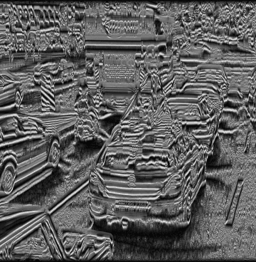
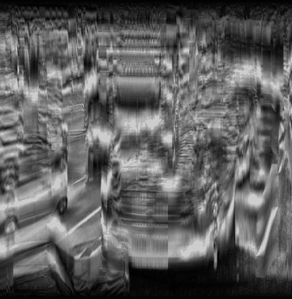
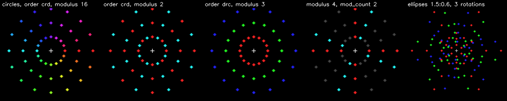
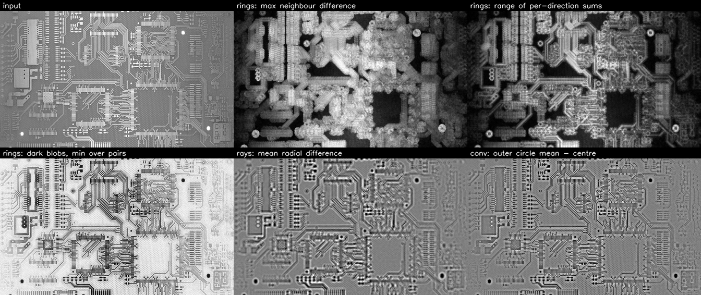
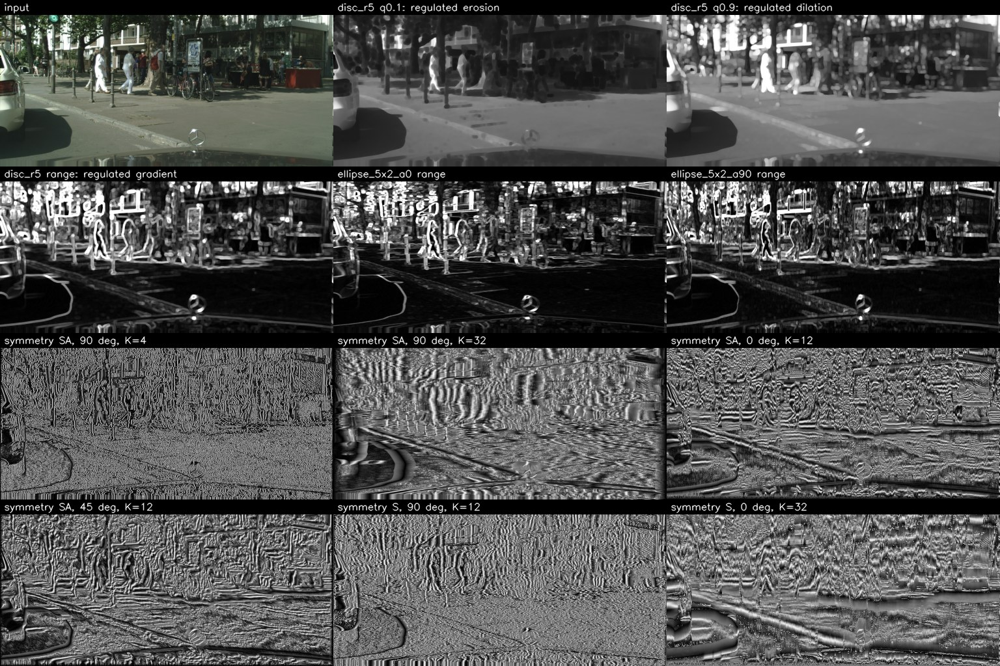
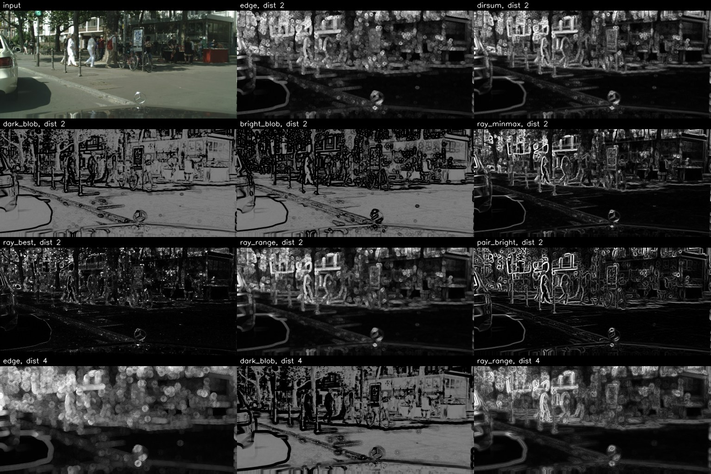
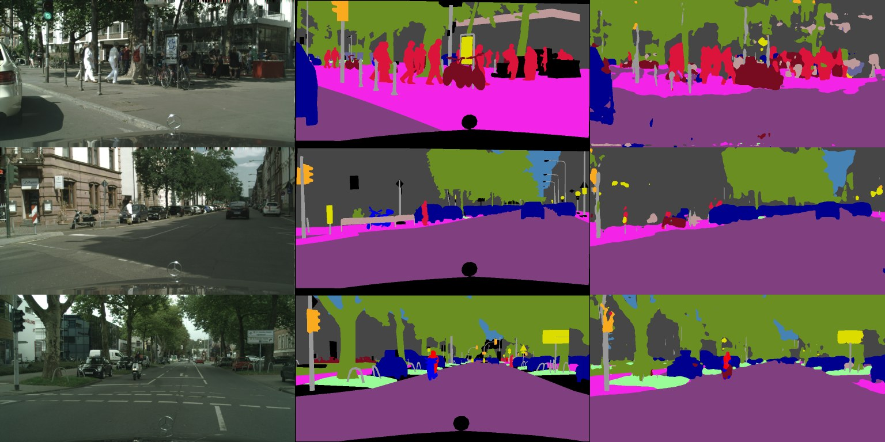

# img-proc

GPU image-processing experiments with [PyCUDA](https://documen.tician.de/pycuda/). The CUDA
kernels live in `cuda/` as plain `.cu` files; the Python scripts read and compile them at run time.

| Topic | Python | CUDA kernels |
| --- | --- | --- |
| Symmetry detection | `sym_measure_example.py` | `cuda/sym_measure.cu` |
| Regulated morphological erosion, rank filter | `regulated_morph.py` | `cuda/regulated_morph_erosion.cu` |
| Colour rank filter, segmentation feature maps | `regulated_morph.py`, `morph_features.py`, `structuring_elements/` | `cuda/morph_features.cu` |
| Difference filters on circular sampling patterns | `diff_filter.py` | `cuda/diff_filter.cu` |

## Requirements

- An NVIDIA GPU with the CUDA toolkit (`nvcc` on the `PATH`). The kernels use legacy texture
  references, which CUDA 12 removed, so use CUDA 11.
- Python 3.10 with `pycuda`, `numpy`, `opencv-python` and `Pillow` (Pillow is only needed for the GIF).

The kernels are compiled with `arch='sm_80'`; change that argument in the `SourceModule(...)`
calls if your GPU needs a different target.

## Symmetry detection

`sym_measure_example.py` implements the two methods of Zielke, Brauckmann and von Seelen,
*Intensity and Edge-Based Symmetry Detection Applied to Car-Following* (ECCV 1992, `eccv_92.pdf`).

```
python sym_measure_example.py
```

The input is `street_view.jpg`.

### Intensity symmetry per pixel

For a scan line through a pixel, the intensities on both sides are split into an even and an
odd part. Comparing their energies gives a symmetry measure `S` in [-1, 1] (1 = mirror
symmetric, -1 = antisymmetric). Weighting `S` by the width of the interval gives the axis
confidence `SA` in [0, 1], so wide symmetric intervals count more than narrow ones.

`symmetry_image(angle)` returns, for every pixel, the largest `SA` over all interval widths,
the width where it occurs, and `S` at that width. The angle sets the scan direction:
0 scans along y (horizontal symmetry axes), π/2 scans along x (vertical axes).

`symmetry_angle_series()` renders `SA` for 30 scan angles from 0 to π/2 into `sym_series/`
as PNG frames and an animated GIF. All frames share one grey scale (`SA = 1` is white).

`MAX_HALF_WIDTH` sets the largest half-width of the interval tested around each pixel, and
with it the scale of the structures that respond. A small value picks out fine local detail
such as edges, lane markings and car contours; a large value responds to symmetry of whole
objects and regions.

| `MAX_HALF_WIDTH = 20` | `MAX_HALF_WIDTH = 150` |
| --- | --- |
|  |  |

### Symmetry histogram

`symmetry_histogram(horizontal=False)` sums `SA` over parallel scan lines for every axis
position and interval width. Its peaks are the symmetry axes of the image. It handles vertical
axes (`horizontal=False`) and horizontal axes (`horizontal=True`). The script writes the
histograms to `result_hist_vertical.png` and `result_hist_horizontal.png`.

### SEED, the symmetry-enhancing edge detector

`seed_image(axis_pos, max_dist, horizontal=False)` keeps only the edges that have a
mirror-symmetric counterpart across a given axis. Each pixel is paired with its mirror point;
eight directional edge responses on both sides are compared through the compatibility table of
the paper's Fig. 3. The script runs SEED at the strongest axis of each orientation and writes
`result_seed_vertical.png` and `result_seed_horizontal.png`.

## Regulated morphological erosion

`regulated_morph.py` implements a noise-tolerant version of morphological erosion. It works on binary images. [Gady Agam, Its’hak Dinstein,
Regulated morphological operations,
Pattern Recognition,
Volume 32, Issue 6,
1999,
Pages 947-971,
ISSN 0031-3203,]

Ordinary erosion keeps a foreground pixel only if every pixel under the structuring element
is foreground. Regulated erosion relaxes this with a `strictness` parameter: a pixel survives
if at most `strictness - 1` pixels under the structuring element are background. Strictness 1
is ordinary erosion; larger values erode less and are more tolerant of noise and small holes.

```python
from regulated_morph import gen_morph_kernel, regulated_erosion

kernel = gen_morph_kernel(4)                    # disc of radius 4, 49 pixels
eroded = regulated_erosion(binary, kernel, strictness=8)
```

### Binary images

```
python regulated_erosion_example.py
```

Thresholds `circuit.jpg` (Otsu) and erodes it with a radius-4 disc at several strictness
values. Results go to `regulated_erosion_out/`.


### Greyscale images: order-statistic filter

The idea of binary regulated morphological operator are extended with a consideration of non-linear order statistics filter for greyscale, and rgb images. The greyscale version is an order-statistic (rank) filter. With strictness as the rank, the
output is the smaller of the pixel's own value and the `strictness`-th smallest intensity under
the structuring element. On a 0/255 image this gives exactly the binary result.

- `regulated_erosion_gray(image, kernel, strictness)`: greyscale regulated erosion.
- `rank_filter(image, kernel, rank)`: the plain rank filter. Rank 1 is the minimum (erosion),
  the middle rank is the median, the top rank is the maximum (dilation).

Both take 8-bit images. The kernel does not sort: it finds the rank-th smallest value by
bisecting the 0–255 intensity range, counting the neighbours at or below the midpoint in
each of 8 passes.

```
python regulated_erosion_gray_example.py
```

Results go to `regulated_erosion_gray_out/`.


### Notes

- Structuring-element pixels outside the image count as background (intensity 0), so low
  strictness values darken a band of up to one radius along the image border.
- `gen_morph_kernel` returns `(dx, dy)` offsets. 
## Colour images and feature maps for segmentation

```
python morph_features_example.py
```

Reads `bumble.jpg` and writes its results to `morph_features_out/`.

### Colour regulated erosion

Colours have no natural order, so "the rank-th smallest colour" needs a definition.
`rank_filter_color` and `regulated_erosion_color` in `regulated_morph.py` offer two:

- `ordering='luminance'` (default): vector ordering. The pixels under the structuring
  element are ordered by brightness and the whole colour of the rank-th darkest pixel is
  returned. Every output colour exists in the neighbourhood, so no false colours appear.
- `ordering='marginal'`: each channel is rank-filtered on its own. This is exactly the
  greyscale filter per channel, but it can combine channels from different pixels into
  colours that are not in the image.

On a grey image stored as colour, both give the greyscale regulated erosion.


### Structuring elements

The `structuring_elements/` package defines the neighbourhoods the filters work on. A
`StructuringElement` holds `(dx, dy)` offsets and, optionally, one weight per offset.

| Module | Kind | Elements |
| --- | --- | --- |
| `shapes.py` | flat, for rank and morphological filters | `disc`, `ring`, `ellipse`, `rectangle`, `square`, `line`, `cross` |
| `haar.py` | weighted, for linear filters | `haar_edge`, `haar_line`, `haar_center_surround`, `haar_checker` |
| `bank.py` | ready-made lists over several scales | `flat_bank`, `haar_bank` |

Haar-like elements have a positive and a negative region, scaled so that the response is the
mean of the positive region minus the mean of the negative region. `StructuringElement.from_mask`
builds an element from any 2D array. All functions in `regulated_morph.py` accept a flat
`StructuringElement` in place of an offset array.

The default bank (white: in the element or positive weight, black: negative weight):


### MorphFeatureMap

`MorphFeatureMap` in `morph_features.py` turns an image into a stack of per-pixel feature
planes, meant as the input of a shallow convolutional network for segmentation.

For every colour channel it computes:

- the raw intensity;
- for each flat element, one plane per quantile of the intensities under the element. A low
  quantile is a noise-tolerant erosion, 0.5 is the median and a high quantile is a
  noise-tolerant dilation. Their range (highest minus lowest quantile) is a morphological
  gradient, a measure of local contrast;
- for each weighted element, its linear response (Haar-like edge, line, blob and corner features).

```python
import cv2
import torch
from morph_features import MorphFeatureMap

feature_map = MorphFeatureMap()                      # default bank, RGB, quantiles 0.1 / 0.5 / 0.9
features = feature_map.compute(cv2.imread("bumble.jpg"))   # float32, (135, height, width)
print(feature_map.feature_names[:4])                 # ['raw/r', 'raw/g', 'raw/b', 'disc_r2/q0.1/r']

net = torch.nn.Sequential(
    torch.nn.Conv2d(feature_map.n_features, 32, kernel_size=3, padding=1), torch.nn.ReLU(),
    torch.nn.Conv2d(32, 2, kernel_size=1))            # 2 classes
logits = net(torch.from_numpy(features)[None])       # (1, 2, height, width)
```

- **Layout:** channel-first `float32`. Quantile, raw and range planes are in [0, 1]; Haar planes
  are in [-1, 1].
- **Options:** `flat_elements` and `weighted_elements` take your own lists of elements,
  `quantiles` sets the order statistics, and `color_space` is `'rgb'`, `'bgr'`, `'lab'`, `'hsv'`
  or `'gray'`.
- **Size:** the default bank gives 135 planes (3 raw + 8 flat elements × 4 planes × 3 channels
  + 12 Haar elements × 3 channels). For a 600 × 1160 image that is 376 MB; pass a smaller
  bank or fewer quantiles to reduce it.
- **Border:** element pixels outside the image reuse the nearest image pixel, so the features
  have no dark frame. (The erosion functions above count outside pixels as black instead.)

A selection of feature planes (Haar planes are shown with zero as mid-grey):


## Difference filters on circular sampling patterns

```
python diff_filter_example.py     # patterns and filter responses for circuit.jpg, in diff_filter_out/
python diff_filter_check.py       # the kernels against NumPy, and against transcriptions of t.cu
```

### Sampling pattern

`sampling_pattern(circles, dist, directions, rotations, x_ratio, y_ratio, order, swap_axes)`
returns an ordered list of points around a pixel: `directions` points on each of `circles`
concentric circles with radii `dist`, `2 dist`, ... Different `x_ratio` and `y_ratio` turn the
circles into ellipses, and `rotations` adds rotated copies of the whole pattern.

The order of the points matters, because point `i` (counted from 0) belongs to the modulo class
`(i + 1 - mod_offset) mod modulus`. `order` sets the nesting of the generating loops, outermost
first, with `c` for circles, `r` for rotations and `d` for directions (the numbers 1 to 6 of
`createFilter.m` are accepted too). With `'crd'` consecutive points walk around a circle; with
`'drc'` they walk outwards along a ray. Only the classes `0 .. mod_count-1` take part in a filter.

`SamplingPattern.render()` draws a pattern with one colour per class (unused points grey):



### general_filter

```python
from diff_filter import general_filter, sampling_pattern

pattern = sampling_pattern(circles=3, dist=3, directions=16)
out = general_filter(image, pattern, modulus=16, stat='sum', alpha='range')
```

The filter works in three steps:

| Step | Argument | Options |
| --- | --- | --- |
| Value of a point with intensity `v`, centre intensity `c` | `gamma` | `'diff'` v - c, `'neg_diff'` c - v, `'abs_diff'` \|v - c\|, `'min2'` 2 min(v, c), `'pos_diff'` max(v - c, 0) |
| Which points form a pair | `pairing`, `pair_stride` | `'neighbour'`: the next point of the sequence; `'same_class'`: the next point of the same class; an integer `k`: the point `k` places later; `'none'`: no pairs, every point counts on its own. `pair_stride=2` keeps only the disjoint pairs (0, 1), (2, 3), ... |
| Value of a pair | `beta` | `'diff'` second - first, `'min2'` 2 min(first, second) |
| Statistic of the pair values per class | `stat` | `'max'`, `'min'`, `'sum'`, or `'pooled'` (all pairs in one set) |
| Reduction over the classes | `alpha` | `'min'`, `'max'`, `'sum'`, `'mean'`, `'range'`, `'neg_range'` |

A pair belongs to the class of its first point. Images are `(h, w)` or a stack `(n, h, w)` of any
numeric type; the result is `float32`. Sampling points outside the image use the nearest pixel.

`conv_filter(image, pattern, weights, centre_weight)` is the linear filter on the same pattern.
`legacy_modes(modeA, modeB, modeC)` translates the mode numbers of `diffFilter.m` into these
arguments.



### diff_filter1 to diff_filter6

The six fixed filters of `t.cu` that preceded `generalFilter`. Each is one setting of
`general_filter()`, so they share its kernel. `D` is the rectified point value max(v - c, 0).

| Function | Result | As `general_filter` arguments |
| --- | --- | --- |
| `diff_filter1(image, pattern, offset, modulus)` | range of `D[i] - D[i - offset]` over the points `i` that are a multiple of `modulus` | `pos_diff`, `diff`, `pairing=offset`, `pooled`, `range` |
| `diff_filter2(image, pattern, modulus, mod_offset, mod_count)` | range of the neighbour differences in the classes `0 .. mod_count-2` | `pos_diff`, `diff`, `pooled`, `range` |
| `diff_filter3(...)` | range of 2 min(D[i], D[i+1]) in the classes `0 .. mod_count-1` | `pos_diff`, `min2`, `pooled`, `range` |
| `diff_filter4(...)` | largest per-class sum of 2 min(D[i], D[i+1]) over disjoint pairs, divided by the points per class | `pos_diff`, `min2`, `pair_stride=2`, `sum`, `max` |
| `diff_filter5(...)` | largest over the classes of the smallest \|v - c\| in the class | `abs_diff`, `pairing='none'`, `min`, `max` |
| `diff_filter6(image, pattern)` | largest `D[i+1] - D[i]` over disjoint pairs | `pos_diff`, `diff`, `pair_stride=2`, `pooled`, `max` |

`diffFilter5` took its classes as two matrices; `pattern_from_classes()` turns a list of
per-class offsets into an ordered pattern. `diffFilterTest` computed the same as `diffFilter1`.

`diff_filter_check.py` compares each of them with a line-by-line NumPy transcription of the
original kernel, for parameters where the quirks below have no effect; they agree exactly.

Quirks of the originals that the port does not keep:

- `diffFilter1` skipped the pair that starts at the first point.
- `diffFilter2` and `diffFilter3` tested every class but kept only the result for the last
  one, so only one class counted, and every pair outside it entered the range as 0.
- `diffFilter4` truncated the result to an integer.
- `diffFilter5` indexed the class matrices with the wrong stride (right only for as many
  classes as points per class), and a padding entry set the minimum of its class to 0.
  The port needs equally sized classes and has no padding.
- `diffFilter6` started its maximum at -1.
- With no pair at all the originals returned the difference of their start values; the port
  returns 0.


## Segmentation network on morphology and symmetry features (PyTorch)

`segnet/` holds a compact segmentation network, MorphSymNet, whose input is a stack of
regulated-morphology and symmetry planes, and an ablation on Cityscapes that tests whether
those planes help.

```
python -m segnet.build_cache                          # once: 512 x 1024 uint8 cache in cache/
python -m segnet.check_features                       # front-ends vs the kernels above
python -m segnet.train --features rgb,morph,sym       # any of rgb, morph, sym, haar, diff
python -m segnet.report                               # table of all runs in runs/
python -m segnet.predict --run rgb+morph+sym_s0       # image | ground truth | prediction
```

| File | Content |
| --- | --- |
| `features.py` | `RegulatedMorphFeatures`, `SymmetryFeatures`, `FeatureFrontEnd` in plain PyTorch |
| `features_cuda.py`, `cuda/segnet_features.cu` | the same features as batched CUDA kernels that run on PyTorch tensors |
| `diff_bank.py` | the difference-filter bank of the `diff` group |
| `guided_upsample.py` | `GuidedUpsample`: image-guided upsampling of the logits |
| `learnable_diff.py`, `check_learnable_diff.py` | `LearnableDiffFilter`: `generalFilter` with trained parameters, and its check against the kernel |
| `model.py` | `MorphSymNet` |
| `train.py`, `report.py`, `predict.py` | training, summary, prediction montage |
| `build_cache.py` | half-resolution dataset cache, labelIds to the 19 trainIds |

### Input planes

53 planes at full resolution by default: 3 raw RGB, 32 morphology and 18 symmetry planes;
optionally 12 Haar planes. All but RGB are computed on the 8-bit luminance.

- **Morphology:** the default `flat_bank()` (8 elements); per element the quantiles 0.1, 0.5
  and 0.9 and their range. Identical to the flat part of `MorphFeatureMap`.
- **Symmetry:** scan angles 0, 45 and 90 degrees, half-widths 4, 12 and 32 px; per pair the
  axis confidence `SA` and the symmetry measure `S`. One pass up to the largest half-width
  serves all three, because `SA` for a smaller half-width is a rescaled running maximum.
- **Haar (optional):** the default `haar_bank()` (12 elements), identical to the weighted part
  of `MorphFeatureMap`.

- **Difference filters (optional, `diff`):** 16 planes from `generalFilter` (see above), on a
  pattern of 3 circles x 16 directions with modulus 16, so that a class is one direction.
  Eight filters at circle spacings 2 and 4 px:

  | Filter | Responds to |
  | --- | --- |
  | `edge` | largest step between neighbouring points on the circles |
  | `dirsum` | range over directions of the summed angular differences |
  | `dark_blob`, `bright_blob` | centre darker / brighter than the whole surround |
  | `ray_minmax` (`diff_filter5`) | a direction on which every point differs from the centre |
  | `ray_best` | how different the most similar direction is: small on lines and edges |
  | `ray_range` | most different minus most similar direction |
  | `pair_bright` (`diff_filter4`) | strongest direction pair brighter than the centre |

  `--diff-bank` selects a part: `small` (spacing 2), `large` (spacing 4), `pooled` (`edge` and
  the blobs), `direction` (the per-direction filters). The bank takes about 29 ms for a batch
  of 8 crops.





The CUDA backend attaches PyCUDA to PyTorch's CUDA context and passes tensor pointers to the
kernels. For a batch of 8 crops of 384 x 768 the front-end takes about 48 ms, against about
520 ms with tensor operations. Do not import `gpu_kernels` in the same process: it creates a
second context.

### Network

5.6 M parameters. The first 3x3 stride-2 convolution reads all planes, so no full-resolution
activation is stored. Then a second stride-2 convolution, residual stages at 1/4, 1/8 and 1/16
(64, 128, 256 channels, the last two blocks dilated), a pyramid-pooling context module, and a
decoder that fuses the 1/8 and 1/4 skips. Logits are upsampled 4x.

### Result on Cityscapes

2,975 train and 500 val images at 512 x 1024, 20 epochs from scratch, crops of 384 x 768,
AdamW, same crops in the same order for every run. The train folder also contains the
Cityscapes test cities, whose masks are empty; `build_cache.py` skips them.

| Input | Planes | val mIoU % | Inference, 512 x 1024 |
| --- | --- | --- | --- |
| RGB | 3 | 48.71 (48.98, 48.45) | 5.4 ms |
| RGB + Haar | 15 | 48.56 (48.19, 48.93) | 9.1 ms |
| RGB + soft difference filters, fixed (`--learn-diff --ld-freeze`) | 3 + 8 at 1/2 | 48.51 (49.34, 47.69) | not measured |
| RGB + learnable difference filters (`--learn-diff`) | 3 + 8 at 1/2 | 48.25 (48.83, 47.66) | not measured |
| RGB + difference filters, gated (`--gate`) | 19 | 48.04 (48.18, 47.90) | not measured |
| RGB + morphology + symmetry, BatchNorm on the planes | 53 | 47.47 | not measured |
| RGB + difference filters, spacing 2 (`--diff-bank small`) | 11 | 47.37 | not measured |
| RGB + difference filters, spacing 4 (`--diff-bank large`) | 11 | 47.23 | not measured |
| RGB + difference filters, pooled (`--diff-bank pooled`) | 9 | 47.23 | not measured |
| RGB + morphology + symmetry, gated (`--gate`) | 53 | 47.32 | not measured |
| RGB + morphology + symmetry | 53 | 47.19 (47.02, 47.35) | 17.2 ms |
| RGB + difference filters, full bank | 19 | 47.03 (47.20, 46.85) | not measured |
| RGB + difference filters, per direction (`--diff-bank direction`) | 13 | 46.91 | not measured |
| RGB + symmetry | 21 | 46.82 | 7.8 ms |
| RGB + morphology + symmetry + Haar | 65 | 46.47 | 22.2 ms |
| RGB + range planes + symmetry at half-width 4 (`--morph-planes range --sym-half-widths 4`) | 17 | 46.27 | 16.0 ms |
| RGB + morphology + symmetry through a side stem at 1/4 (`--inject quarter`) | 53 | 45.88 | 19.2 ms |
| RGB + morphology | 35 | 45.31 | 14.7 ms |

Values in brackets are the two seeds; rows without brackets are one seed. Two seeds of one
configuration differ by 0.3 to 0.7 points.

In this setting no feature group improves on RGB. The Haar bank (`--features rgb,haar`, the
default `haar_bank()` on the luminance, as one fixed convolution) is on par with RGB; every
configuration with morphology or symmetry planes is 1.2 to 3.4 points below it, wherever the
planes enter the network. The difference-filter bank is 1.3 to 1.8 points below RGB, and
its parts differ from each other by less than the spread between seeds.

With little data (`--subset 300 --epochs 100`: a fixed random subset of 300 training images)
the full feature set ties with RGB and the difference-filter bank stays below it:

| Input | val mIoU % |
| --- | --- |
| RGB + morphology + symmetry | 39.38 (39.92, 38.84) |
| RGB | 39.06 (38.97, 39.16) |
| RGB + difference filters | 38.28 (38.23, 38.33) |

### Gate and robustness

`--gate` multiplies every non-RGB plane by a learnable scalar that starts at 0, so training
starts as the RGB network. It recovers about one point for the difference filters (47.03 to
48.04, both seeds) and nothing measurable for morphology + symmetry; neither reaches RGB.
The learned scalars show which planes the network uses: all 24 quantile planes stay at 0.00
and only range planes are used, mainly those of the two 2x1 ellipses; of the difference
filters `ray_best` at spacing 2 gets by far the largest scalar (0.65 and 0.68 in magnitude
in the two seeds), then `dark_blob`, while `edge` and `ray_range` stay at 0.

`python -m segnet.robustness` evaluates the trained models on changed validation images
(brightness, contrast, gamma, Gaussian noise; 13 changes). val mIoU %:

| Input | Clean | Mean over the 13 changes | Noise sigma 0.02 | Noise sigma 0.05 |
| --- | --- | --- | --- | --- |
| RGB | 48.7 | 36.6 | 39.6 | 18.5 |
| RGB + Haar | 48.6 | 37.9 | 40.2 | 24.0 |
| RGB + difference filters, gated | 48.0 | 35.2 | 31.8 | 14.1 |
| RGB + difference filters | 47.0 | 34.9 | 31.4 | 14.1 |
| RGB + morphology + symmetry | 47.2 | 33.1 | 16.3 | 6.4 |

The fixed planes give no robustness advantage. Brightness, contrast and gamma changes cost
every model about the same; noise costs the models with morphology and symmetry planes far
more than RGB. Haar is slightly ahead of RGB, mostly under noise, where the two RGB seeds
differ by 7 points at sigma 0.05.

### Learnable difference filters

`LearnableDiffFilter` (`segnet/learnable_diff.py`) is `generalFilter` with every fixed option
replaced by a continuous family that contains it, trained with the network:

| Stage | `generalFilter` | Learnable form, per filter |
| --- | --- | --- |
| input | 8-bit luminance | colour mix `k . (r, g, b)` |
| points | integer offsets on circles | radius per circle, axis ratio and rotation; bilinear sampling |
| gamma | `v-c`, `c-v`, `abs(v-c)`, `max(v-c,0)`, `2 min(v,c)` | `w1 v + w2 c + w3 abs(v-c)` |
| beta, pairing | `b-a`, `2 min(a,b)`, or no pairs; step in the sequence | `u0 a + sum_k (u1k b_k + u2k abs(a-b_k))` over three partners: next direction, next circle, opposite point |
| stat | max, min, sum per class | soft pooling over the circles of a direction |
| alpha | min, max, sum, mean, range | `P(ta) - rho P(tb)`, soft pooling over the directions |

Soft pooling is `sum softmax(t x) x`: max, min and mean for `t` to +inf, -inf and 0. The
centre reference, the classes (one direction each) and the pooling over directions stay
fixed. Every filter starts as one filter of the bank above. With hard pooling, 4 directions
and stride 1 the layer reproduces `generalFilter` to 3e-5 for the presets without pairs
(`python -m segnet.check_learnable_diff`); pairs differ by design, they wrap around the
circle.

`--learn-diff` computes 8 filters (the 8 presets, 3 circles x 8 directions, radii 2, 4, 6 px)
from RGB at half resolution and adds them to the output of the first convolution through a
1x1 convolution and a zero-initialised BatchNorm. `--ld-freeze` keeps the filters at their
initial setting, as the control. The layer has 176 parameters and adds about 1.4 minutes per
epoch (2.0 against 0.6 for RGB).

Result (table above): learnable 48.25, frozen 48.51, RGB 48.71. The three are within the
spread of the seeds, so learning the filter parameters gives no measurable gain in this
setting.

The parameters do move, and some changes are the same in both seeds
(`python -m segnet.report` prints all of them):

- `ray_best`: the ellipse stretches to an axis ratio of about 2 (2.13, 1.97), the weight of
  `abs(v-c)` doubles, and it adds `abs(a-b)` of the opposite point (+1.02, +1.00) and of the
  next circle (+0.86, +0.93).
- `ray_range`: the opposite point enters with weight +1.15 and +1.19.
- `dark_blob` moves towards a harder minimum (temperature -40 to -65 and -71).
- Radii move by at most 0.7 px and no preset turns into another one.

### Photometric augmentation

`--augment` adds random brightness, contrast, gamma, saturation and Gaussian noise per image
to the random scale, crop and flip that every run uses. The crops stay the same as without
it. val mIoU %, 20 epochs, two seeds:

| Input | Clean | Mean over the 13 changes | Noise sigma 0.02 | Noise sigma 0.05 |
| --- | --- | --- | --- | --- |
| RGB | 48.7 (48.98, 48.45) | 36.6 | 39.6 | 18.5 |
| RGB, `--augment` | 45.9 (46.10, 45.73) | 44.0 | 45.3 | 41.6 |
| RGB + learnable difference filters | 48.2 (48.83, 47.66) | 36.1 | 37.6 | 17.6 |
| RGB + learnable difference filters, `--augment` | 45.3 (45.35, 45.25) | 43.1 | 44.5 | 41.3 |
| RGB + soft difference filters, fixed | 48.5 (49.34, 47.69) | 37.0 | 40.1 | 18.9 |

At 20 epochs the augmentation costs about 2.8 points on clean images and makes the network
almost insensitive to the changes: the loss under them falls from 12 points to 2. The test
changes are of the same kind as the augmentation, with wider extremes, so this is not an
out-of-distribution test any more. The learnable difference filters stay 0.5 to 0.9 points
below RGB with and without augmentation, and give no robustness of their own.

### Longer schedule and image-guided upsampling

`--ema 0.999` also evaluates an exponential moving average of the weights; runs of a length
other than 20 epochs get an `_ep<N>` tag. `--guided-up` replaces the bilinear upsampling of
the logits by `GuidedUpsample` (`segnet/guided_upsample.py`): every full-resolution pixel
takes a weighted mean of the logits at 16 points (8 directions, radii 2 and 4 px), weighted
by the colour similarity of the point to the centre pixel. In the terms of `generalFilter`:
gamma = `abs(v-c)` on the image, alpha = a soft pooling whose weights come from the image and
whose values are the logits. The colour mix, a sigma per circle and a bias per point are
learned.

60 epochs, three seeds, val mIoU %:

| Input | Last weights | Averaged weights | Training |
| --- | --- | --- | --- |
| RGB | 61.76 (61.19, 62.16, 61.95) | 61.95 (61.65, 62.34, 61.87) | 37 min |
| RGB + guided upsampling | 61.89 (61.73, 61.55, 62.39) | 61.86 (61.90, 61.71, 61.96) | 118 min |

Tripling the schedule adds 13 points; guided upsampling adds nothing measurable and triples
the training time. Per class it gains on small and thin classes in all three seeds (traffic
light +1.1, sidewalk +0.4) and loses on fence (-2.2 in all three); the large classes do not
move. Put on the 20-epoch RGB networks without training, with a hand-set sigma, it gives +0.1.

What it learns is the same in all three seeds: the points at radius 2 are switched off
(sigma goes to 0), the points at radius 4 stay with sigma 0.076, and the guide turns from RGB
into opponent colours, about `2R - 1.6G`, `G` and `2B - 1.4G`.

Runs are short, at half resolution, with one or two seeds, so the numbers are not comparable
to published Cityscapes results.


